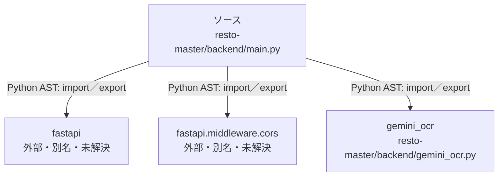

# dependency-map/n-resto-master-backend-main-py-5fb7c4

[解析トップへ戻る](../../README.md)

確認済みファイル: `resto-master/backend/main.py`

解析: Python AST。静的なimport／export参照です。関数の実行順序やHTTP通信は表していません。

宣言: `ocr_menu_gemini`

- `fastapi` → 外部・標準ライブラリ・別名など。ローカル対応先は未確定
- `fastapi.middleware.cors` → 外部・標準ライブラリ・別名など。ローカル対応先は未確定
- `gemini_ocr` → `resto-master/backend/gemini_ocr.py`（内容確認済み）

## 要素の説明

### n-fastapi-41a137

参照名: `fastapi`

ローカルのソース対応先を確定できませんでした。外部ライブラリ、標準ライブラリ、型別名などを区別する追加確認が必要です。

### n-fastapi-middleware-cors-ab8086

参照名: `fastapi.middleware.cors`

ローカルのソース対応先を確定できませんでした。外部ライブラリ、標準ライブラリ、型別名などを区別する追加確認が必要です。

### n-gemini-ocr-d61eb8

参照名: `gemini_ocr`

対応する実在ソース: `resto-master/backend/gemini_ocr.py`。内容確認済み。

### source

`resto-master/backend/main.py` の内容を確認しました。

