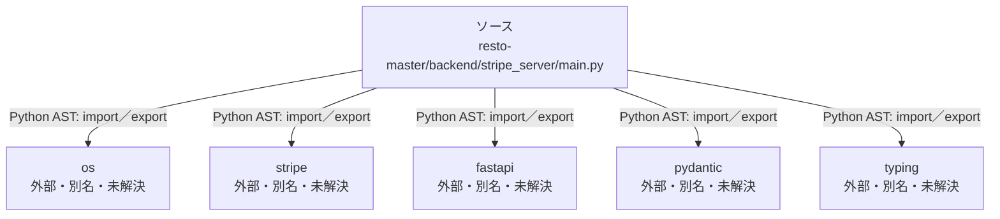

# dependency-map/n-resto-master-backend-stripe-server-main-py-70d2d8

[解析トップへ戻る](../../README.md)

確認済みファイル: `resto-master/backend/stripe_server/main.py`

解析: Python AST。静的なimport／export参照です。関数の実行順序やHTTP通信は表していません。

宣言: `CreateSessionRequest`, `VerifyRequest`, `read_root`, `create_checkout_session`, `verify_payment`

- `os` → 外部・標準ライブラリ・別名など。ローカル対応先は未確定
- `stripe` → 外部・標準ライブラリ・別名など。ローカル対応先は未確定
- `fastapi` → 外部・標準ライブラリ・別名など。ローカル対応先は未確定
- `pydantic` → 外部・標準ライブラリ・別名など。ローカル対応先は未確定
- `typing` → 外部・標準ライブラリ・別名など。ローカル対応先は未確定

## 要素の説明

### n-fastapi-41a137

参照名: `fastapi`

ローカルのソース対応先を確定できませんでした。外部ライブラリ、標準ライブラリ、型別名などを区別する追加確認が必要です。

### n-os-999a34

参照名: `os`

ローカルのソース対応先を確定できませんでした。外部ライブラリ、標準ライブラリ、型別名などを区別する追加確認が必要です。

### n-pydantic-196fee

参照名: `pydantic`

ローカルのソース対応先を確定できませんでした。外部ライブラリ、標準ライブラリ、型別名などを区別する追加確認が必要です。

### n-stripe-2fcb5a

参照名: `stripe`

ローカルのソース対応先を確定できませんでした。外部ライブラリ、標準ライブラリ、型別名などを区別する追加確認が必要です。

### n-typing-02d7d3

参照名: `typing`

ローカルのソース対応先を確定できませんでした。外部ライブラリ、標準ライブラリ、型別名などを区別する追加確認が必要です。

### source

`resto-master/backend/stripe_server/main.py` の内容を確認しました。

