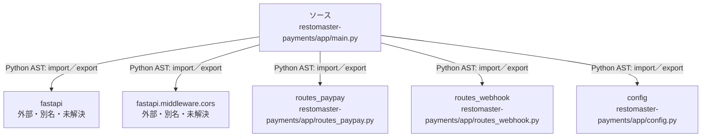

# dependency-map/n-restomaster-payments-app-main-py-cdb4cf

[解析トップへ戻る](../../README.md)

確認済みファイル: `restomaster-payments/app/main.py`

解析: Python AST。静的なimport／export参照です。関数の実行順序やHTTP通信は表していません。

宣言: `root`, `health`

- `fastapi` → 外部・標準ライブラリ・別名など。ローカル対応先は未確定
- `fastapi.middleware.cors` → 外部・標準ライブラリ・別名など。ローカル対応先は未確定
- `routes_paypay` → `restomaster-payments/app/routes_paypay.py`（内容確認済み）
- `routes_webhook` → `restomaster-payments/app/routes_webhook.py`（内容確認済み）
- `config` → `restomaster-payments/app/config.py`（一覧確認・内容未読）

## 要素の説明

### n-config-dfba7a

参照名: `config`

対応する実在ソース: `restomaster-payments/app/config.py`。内容は未読。

### n-fastapi-41a137

参照名: `fastapi`

ローカルのソース対応先を確定できませんでした。外部ライブラリ、標準ライブラリ、型別名などを区別する追加確認が必要です。

### n-fastapi-middleware-cors-ab8086

参照名: `fastapi.middleware.cors`

ローカルのソース対応先を確定できませんでした。外部ライブラリ、標準ライブラリ、型別名などを区別する追加確認が必要です。

### n-routes-paypay-f0cdd7

参照名: `routes_paypay`

対応する実在ソース: `restomaster-payments/app/routes_paypay.py`。内容確認済み。

### n-routes-webhook-fc2dc8

参照名: `routes_webhook`

対応する実在ソース: `restomaster-payments/app/routes_webhook.py`。内容確認済み。

### source

`restomaster-payments/app/main.py` の内容を確認しました。

