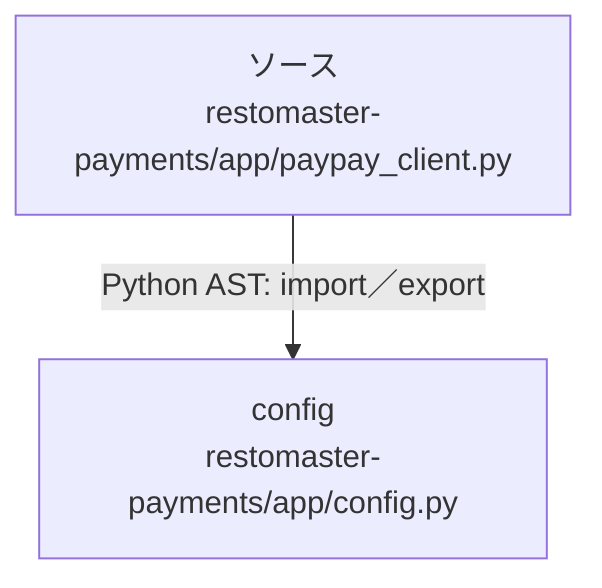

# dependency-map/n-restomaster-payments-app-paypay-client-py-a1b237/imports-2

[解析トップへ戻る](../../../README.md)

import参照の表示用グループ。

## 要素の説明

### n-config-dfba7a

参照名: `config`

対応する実在ソース: `restomaster-payments/app/config.py`。内容は未読。

### source

`restomaster-payments/app/paypay_client.py` の内容を確認しました。

