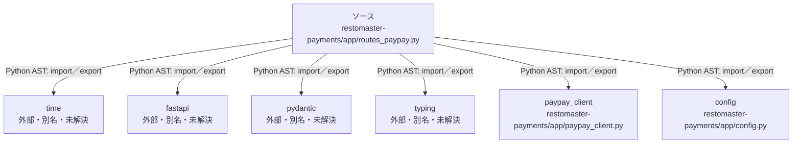

# dependency-map/n-restomaster-payments-app-routes-paypay-py-0963c4

[解析トップへ戻る](../../README.md)

確認済みファイル: `restomaster-payments/app/routes_paypay.py`

解析: Python AST。静的なimport／export参照です。関数の実行順序やHTTP通信は表していません。

宣言: `CreatePayPayRequest`, `CreatePayPayResponse`, `create_paypay_qr`, `PaymentStatusResponse`, `get_payment_status`, `RefundRequest`, `refund_payment`, `check_connection`

- `time` → 外部・標準ライブラリ・別名など。ローカル対応先は未確定
- `fastapi` → 外部・標準ライブラリ・別名など。ローカル対応先は未確定
- `pydantic` → 外部・標準ライブラリ・別名など。ローカル対応先は未確定
- `typing` → 外部・標準ライブラリ・別名など。ローカル対応先は未確定
- `paypay_client` → `restomaster-payments/app/paypay_client.py`（内容確認済み）
- `config` → `restomaster-payments/app/config.py`（一覧確認・内容未読）

## 要素の説明

### n-config-dfba7a

参照名: `config`

対応する実在ソース: `restomaster-payments/app/config.py`。内容は未読。

### n-fastapi-41a137

参照名: `fastapi`

ローカルのソース対応先を確定できませんでした。外部ライブラリ、標準ライブラリ、型別名などを区別する追加確認が必要です。

### n-paypay-client-221266

参照名: `paypay_client`

対応する実在ソース: `restomaster-payments/app/paypay_client.py`。内容確認済み。

### n-pydantic-196fee

参照名: `pydantic`

ローカルのソース対応先を確定できませんでした。外部ライブラリ、標準ライブラリ、型別名などを区別する追加確認が必要です。

### n-time-714eea

参照名: `time`

ローカルのソース対応先を確定できませんでした。外部ライブラリ、標準ライブラリ、型別名などを区別する追加確認が必要です。

### n-typing-02d7d3

参照名: `typing`

ローカルのソース対応先を確定できませんでした。外部ライブラリ、標準ライブラリ、型別名などを区別する追加確認が必要です。

### source

`restomaster-payments/app/routes_paypay.py` の内容を確認しました。

