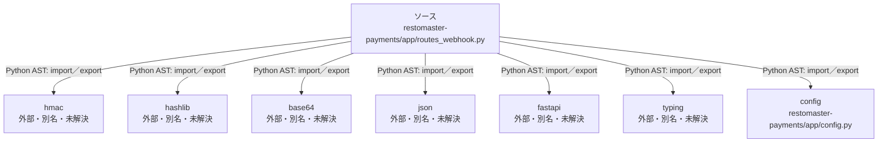

# dependency-map/n-restomaster-payments-app-routes-webhook-py-0055fc

[解析トップへ戻る](../../README.md)

確認済みファイル: `restomaster-payments/app/routes_webhook.py`

解析: Python AST。静的なimport／export参照です。関数の実行順序やHTTP通信は表していません。

宣言: `verify_webhook_signature`, `paypay_webhook`, `payment_thanks`

- `hmac` → 外部・標準ライブラリ・別名など。ローカル対応先は未確定
- `hashlib` → 外部・標準ライブラリ・別名など。ローカル対応先は未確定
- `base64` → 外部・標準ライブラリ・別名など。ローカル対応先は未確定
- `json` → 外部・標準ライブラリ・別名など。ローカル対応先は未確定
- `fastapi` → 外部・標準ライブラリ・別名など。ローカル対応先は未確定
- `typing` → 外部・標準ライブラリ・別名など。ローカル対応先は未確定
- `config` → `restomaster-payments/app/config.py`（一覧確認・内容未読）

## 要素の説明

### n-base64-8095e1

参照名: `base64`

ローカルのソース対応先を確定できませんでした。外部ライブラリ、標準ライブラリ、型別名などを区別する追加確認が必要です。

### n-config-dfba7a

参照名: `config`

対応する実在ソース: `restomaster-payments/app/config.py`。内容は未読。

### n-fastapi-41a137

参照名: `fastapi`

ローカルのソース対応先を確定できませんでした。外部ライブラリ、標準ライブラリ、型別名などを区別する追加確認が必要です。

### n-hashlib-7616ac

参照名: `hashlib`

ローカルのソース対応先を確定できませんでした。外部ライブラリ、標準ライブラリ、型別名などを区別する追加確認が必要です。

### n-hmac-f7ae92

参照名: `hmac`

ローカルのソース対応先を確定できませんでした。外部ライブラリ、標準ライブラリ、型別名などを区別する追加確認が必要です。

### n-json-05d97e

参照名: `json`

ローカルのソース対応先を確定できませんでした。外部ライブラリ、標準ライブラリ、型別名などを区別する追加確認が必要です。

### n-typing-02d7d3

参照名: `typing`

ローカルのソース対応先を確定できませんでした。外部ライブラリ、標準ライブラリ、型別名などを区別する追加確認が必要です。

### source

`restomaster-payments/app/routes_webhook.py` の内容を確認しました。

