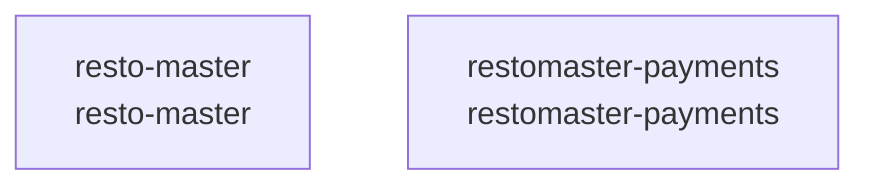

# overall-architecture

[解析トップへ戻る](../README.md)

# Restoaurant-Master

Android飲食店アプリ、OCR、Stripe、PayPayの複数バックエンドを含む構成。

この図はリポジトリ内の構成です。コードを実行した結果やサービス間の通信保証ではありません。

## 対象と根拠

対象: https://github.com/FORIFOR/Restoaurant-Master

取得ブランチ: `main`

Git tree SHA: `b186c9136cb5eec41e0fccf342b67d9792282f55`

ファイル一覧: 6748件。内容確認: 10件。全ファイルの意味解析ではありません。

## 解析の制約

実コードの取得は入口、マニフェスト、直接参照先を中心とする初回解析です。動的ロード、実行時設定、別リポジトリとの接続、ローカル未コミット変更は未確認です。

## 確認が必要な点

構成図の配置関係と、実際の通信・呼び出し関係を区別してください。README上の機能や精度の記述は動作検証済みという意味ではありません。

## 追加解析

未読の中核モジュールから処理順序・データ保存・状態遷移を追加解析する。実行環境で通信先と機能フラグを照合する。

## 補足

2026-10-11の初回解析スナップショットです。現在のコードとの差分や実行環境は追加確認が必要です。

## 要素の説明

### n-resto-master-0be8e0

確認したパス: `resto-master`。配下の登録ファイルは6738件。

- `resto-master/.gradle/8.12/checksums/checksums.lock`（一覧のみ）
- `resto-master/.gradle/8.12/checksums/md5-checksums.bin`（一覧のみ）
- `resto-master/.gradle/8.12/checksums/sha1-checksums.bin`（一覧のみ）
- `resto-master/.gradle/8.12/executionHistory/executionHistory.bin`（一覧のみ）
- `resto-master/.gradle/8.12/executionHistory/executionHistory.lock`（一覧のみ）
- `resto-master/.gradle/8.12/fileChanges/last-build.bin`（一覧のみ）
- `resto-master/.gradle/8.12/fileHashes/fileHashes.bin`（一覧のみ）
- `resto-master/.gradle/8.12/fileHashes/fileHashes.lock`（一覧のみ）
- `resto-master/.gradle/8.12/fileHashes/resourceHashesCache.bin`（一覧のみ）
- `resto-master/.gradle/8.12/gc.properties`（一覧のみ）
- `resto-master/.gradle/9.0.0/checksums/checksums.lock`（一覧のみ）
- `resto-master/.gradle/9.0.0/checksums/md5-checksums.bin`（一覧のみ）
- `resto-master/.gradle/9.0.0/checksums/sha1-checksums.bin`（一覧のみ）
- `resto-master/.gradle/9.0.0/fileChanges/last-build.bin`（一覧のみ）
- `resto-master/.gradle/9.0.0/fileHashes/fileHashes.bin`（一覧のみ）
- `resto-master/.gradle/9.0.0/fileHashes/fileHashes.lock`（一覧のみ）
- `resto-master/.gradle/9.0.0/gc.properties`（一覧のみ）
- `resto-master/.gradle/buildOutputCleanup/buildOutputCleanup.lock`（一覧のみ）
- `resto-master/.gradle/buildOutputCleanup/cache.properties`（一覧のみ）
- `resto-master/.gradle/buildOutputCleanup/outputFiles.bin`（一覧のみ）
- `resto-master/.gradle/config.properties`（一覧のみ）
- `resto-master/.gradle/file-system.probe`（一覧のみ）
- `resto-master/.gradle/vcs-1/gc.properties`（一覧のみ）
- `resto-master/.idea/.gitignore`（一覧のみ）
- `resto-master/.idea/.name`（一覧のみ）
- `resto-master/.idea/AndroidProjectSystem.xml`（一覧のみ）
- `resto-master/.idea/caches/deviceStreaming.xml`（一覧のみ）
- `resto-master/.idea/compiler.xml`（一覧のみ）
- `resto-master/.idea/deploymentTargetSelector.xml`（一覧のみ）
- `resto-master/.idea/gradle.xml`（一覧のみ）
- `resto-master/.idea/inspectionProfiles/Project_Default.xml`（一覧のみ）
- `resto-master/.idea/migrations.xml`（一覧のみ）
- `resto-master/.idea/misc.xml`（一覧のみ）
- `resto-master/.idea/runConfigurations.xml`（一覧のみ）
- `resto-master/app/build.gradle.kts`（内容確認済み）

[詳細な図と説明を見る](n-resto-master-0be8e0/README.md)

### n-restomaster-payments-339a46

確認したパス: `restomaster-payments`。配下の登録ファイルは9件。

- `restomaster-payments/README.md`（一覧のみ）
- `restomaster-payments/app/__init__.py`（一覧のみ）
- `restomaster-payments/app/config.py`（一覧のみ）
- `restomaster-payments/app/main.py`（内容確認済み）
- `restomaster-payments/app/paypay_client.py`（内容確認済み）
- `restomaster-payments/app/routes_images.py`（一覧のみ）
- `restomaster-payments/app/routes_paypay.py`（内容確認済み）
- `restomaster-payments/app/routes_webhook.py`（内容確認済み）
- `restomaster-payments/requirements.txt`（一覧のみ）

