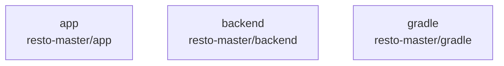

# overall-architecture/n-resto-master-0be8e0

[解析トップへ戻る](../../README.md)

確認したパス: `resto-master`。配下の登録ファイルは6738件。

- `resto-master/.gradle/8.12/checksums/checksums.lock`（一覧のみ）
- `resto-master/.gradle/8.12/checksums/md5-checksums.bin`（一覧のみ）
- `resto-master/.gradle/8.12/checksums/sha1-checksums.bin`（一覧のみ）
- `resto-master/.gradle/8.12/executionHistory/executionHistory.bin`（一覧のみ）
- `resto-master/.gradle/8.12/executionHistory/executionHistory.lock`（一覧のみ）
- `resto-master/.gradle/8.12/fileChanges/last-build.bin`（一覧のみ）
- `resto-master/.gradle/8.12/fileHashes/fileHashes.bin`（一覧のみ）
- `resto-master/.gradle/8.12/fileHashes/fileHashes.lock`（一覧のみ）
- `resto-master/.gradle/8.12/fileHashes/resourceHashesCache.bin`（一覧のみ）
- `resto-master/.gradle/8.12/gc.properties`（一覧のみ）
- `resto-master/.gradle/9.0.0/checksums/checksums.lock`（一覧のみ）
- `resto-master/.gradle/9.0.0/checksums/md5-checksums.bin`（一覧のみ）
- `resto-master/.gradle/9.0.0/checksums/sha1-checksums.bin`（一覧のみ）
- `resto-master/.gradle/9.0.0/fileChanges/last-build.bin`（一覧のみ）
- `resto-master/.gradle/9.0.0/fileHashes/fileHashes.bin`（一覧のみ）
- `resto-master/.gradle/9.0.0/fileHashes/fileHashes.lock`（一覧のみ）
- `resto-master/.gradle/9.0.0/gc.properties`（一覧のみ）
- `resto-master/.gradle/buildOutputCleanup/buildOutputCleanup.lock`（一覧のみ）
- `resto-master/.gradle/buildOutputCleanup/cache.properties`（一覧のみ）
- `resto-master/.gradle/buildOutputCleanup/outputFiles.bin`（一覧のみ）
- `resto-master/.gradle/config.properties`（一覧のみ）
- `resto-master/.gradle/file-system.probe`（一覧のみ）
- `resto-master/.gradle/vcs-1/gc.properties`（一覧のみ）
- `resto-master/.idea/.gitignore`（一覧のみ）
- `resto-master/.idea/.name`（一覧のみ）
- `resto-master/.idea/AndroidProjectSystem.xml`（一覧のみ）
- `resto-master/.idea/caches/deviceStreaming.xml`（一覧のみ）
- `resto-master/.idea/compiler.xml`（一覧のみ）
- `resto-master/.idea/deploymentTargetSelector.xml`（一覧のみ）
- `resto-master/.idea/gradle.xml`（一覧のみ）
- `resto-master/.idea/inspectionProfiles/Project_Default.xml`（一覧のみ）
- `resto-master/.idea/migrations.xml`（一覧のみ）
- `resto-master/.idea/misc.xml`（一覧のみ）
- `resto-master/.idea/runConfigurations.xml`（一覧のみ）
- `resto-master/app/build.gradle.kts`（内容確認済み）

## 要素の説明

### n-resto-master-app-f90570

実在パス: `resto-master/app`。6687ファイル。

- `resto-master/app/build.gradle.kts`
- `resto-master/app/build/generated/hilt/component_sources/debug/com/example/restomaster/DaggerRestoMasterApp_HiltComponents_SingletonC.java`
- `resto-master/app/build/generated/hilt/component_sources/debug/com/example/restomaster/Hilt_RestoMasterApp.java`
- `resto-master/app/build/generated/hilt/component_sources/debug/com/example/restomaster/RestoMasterApp_HiltComponents.java`
- `resto-master/app/build/generated/hilt/component_trees/debug/com/example/restomaster/RestoMasterApp_ComponentTreeDeps.java`
- `resto-master/app/build/generated/hilt/component_trees/debug/dagger/hilt/internal/processedrootsentinel/codegen/_com_example_restomaster_RestoMasterApp.java`
- `resto-master/app/build/generated/ksp/debug/java/com/example/restomaster/Hilt_MainActivity.java`
- `resto-master/app/build/generated/ksp/debug/java/com/example/restomaster/MainActivity_GeneratedInjector.java`
- `resto-master/app/build/generated/ksp/debug/java/com/example/restomaster/RestoMasterApp_GeneratedInjector.java`
- `resto-master/app/build/generated/ksp/debug/java/com/example/restomaster/data/local/AppDatabase_Impl.java`
- `resto-master/app/build/generated/ksp/debug/java/com/example/restomaster/data/local/dao/AllergenFeedbackDao_Impl.java`
- `resto-master/app/build/generated/ksp/debug/java/com/example/restomaster/data/local/dao/BillDao_Impl.java`
- `resto-master/app/build/generated/ksp/debug/java/com/example/restomaster/data/local/dao/BillItemDao_Impl.java`
- `resto-master/app/build/generated/ksp/debug/java/com/example/restomaster/data/local/dao/CallRequestDao_Impl.java`
- `resto-master/app/build/generated/ksp/debug/java/com/example/restomaster/data/local/dao/ClosingDao_Impl.java`
- `resto-master/app/build/generated/ksp/debug/java/com/example/restomaster/data/local/dao/MasterAllergenDao_Impl.java`
- `resto-master/app/build/generated/ksp/debug/java/com/example/restomaster/data/local/dao/MasterMenuItemAllergenDao_Impl.java`
- `resto-master/app/build/generated/ksp/debug/java/com/example/restomaster/data/local/dao/MenuDao_Impl.java`
- `resto-master/app/build/generated/ksp/debug/java/com/example/restomaster/data/local/dao/MenuTranslationDao_Impl.java`
- `resto-master/app/build/generated/ksp/debug/java/com/example/restomaster/data/local/dao/OrderDao_Impl.java`
- `resto-master/app/build/generated/ksp/debug/java/com/example/restomaster/data/local/dao/PaymentDao_Impl.java`
- `resto-master/app/build/generated/ksp/debug/java/com/example/restomaster/data/local/dao/PaymentItemDao_Impl.java`
- `resto-master/app/build/generated/ksp/debug/java/com/example/restomaster/data/local/dao/ReceiptDao_Impl.java`
- `resto-master/app/build/generated/ksp/debug/java/com/example/restomaster/data/local/dao/ReservationDao_Impl.java`
- `resto-master/app/build/generated/ksp/debug/java/com/example/restomaster/data/local/dao/StoreDao_Impl.java`

### n-resto-master-backend-9c6f0b

実在パス: `resto-master/backend`。6ファイル。

- `resto-master/backend/__init__.py`
- `resto-master/backend/gemini_ocr.py`
- `resto-master/backend/main.py`
- `resto-master/backend/requirements.txt`
- `resto-master/backend/stripe_server/main.py`
- `resto-master/backend/stripe_server/requirements.txt`

### n-resto-master-gradle-0fc025

実在パス: `resto-master/gradle`。3ファイル。

- `resto-master/gradle/libs.versions.toml`
- `resto-master/gradle/wrapper/gradle-wrapper.jar`
- `resto-master/gradle/wrapper/gradle-wrapper.properties`

